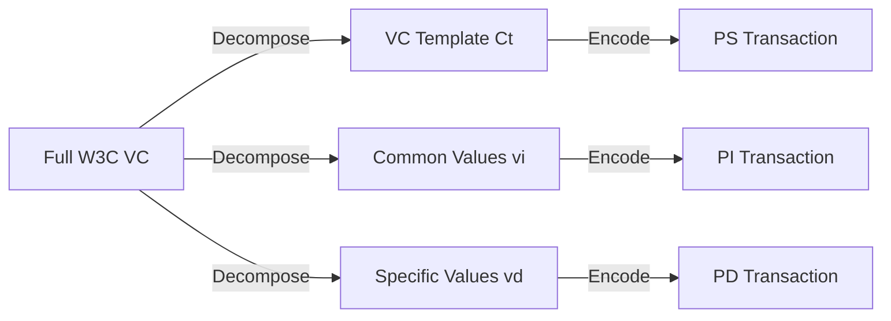

# CertChain-OCVC

**Bitcoin-based On-chain Verifiable Credential System**

CertChain-OCVC is a decentralized academic credential issuance and verification system built on the Bitcoin network. It implements the **OCVC (On-chain Verifiable Credential)** protocol, a framework designed to issue, store, verify, and revoke W3C-compliant Verifiable Credentials (VCs) without relying on smart contracts or centralized databases.

Originally developed as an academic graduation thesis project, CertChain-OCVC has been completely refactored into a production-oriented application. The project emphasizes clean architecture, testability, strict security validation, and maintainability.

## Problem Statement

Traditional digital credentials rely on centralized institutional servers, which introduce single points of failure and require verifiers to blindly trust the issuer's database. While existing blockchain solutions improve transparency, most rely on proprietary data formats, smart contracts, or external off-chain storage, which limits interoperability and increases costs.

CertChain-OCVC solves this by using **Bitcoin** as an immutable trust anchor. By leveraging Bitcoin's UTXO model, `OP_RETURN`, and P2WSH (Pay-to-Witness-Script-Hash), the system provides a tamper-proof, publicly auditable record of credentials.

## Core Concept: VC Decomposition

Bitcoin's strict on-chain data limits (max 80 bytes for `OP_RETURN`, max 3600 bytes for `P2WSH`) make it impossible to store a full W3C VC directly on-chain. Furthermore, a batch of credentials (e.g., 1000 students graduating from the same program) contains massive redundant data (e.g., course descriptions, issuer profile).

To solve this, OCVC introduces **VC Decomposition**, splitting a full credential into three parts:

1. **VC Template (`Ct`)**: The JSON-LD skeleton containing placeholders for dynamic data.
2. **Common Value Array (`vi`)**: Values shared across a batch (e.g., issuer DID, program name, course definitions). **Published once per batch.**
3. **Credential-Specific Value Array (`vd`)**: Values unique to a single credential (e.g., student name, date of birth, specific grades).



By storing the template and common values once, the system achieves **massive scalability**. For each student, only their specific `vd` (or just a Merkle root of a batch) needs to be written to the blockchain.

## How It Works

The protocol relies on three types of Bitcoin transactions:
### 1. Protocol Specification (PS) Transaction

Stores the VC Template (`Ct`) and protocol metadata. Published as a P2WSH (SegWit) transaction. The witness script holds the compressed data, enabling larger storage than `OP_RETURN`.

### 2. Protocol Instance Initialization (PI) Transaction

References the PS transaction ID and publishes the `vi` array (common values). Also uses P2WSH. This forms the "instance anchor" for a specific batch of credentials.

### 3. Protocol Instance Data (PD) Transaction

Publishes the credential-specific `vd` array. Issued as a standard P2PKH transaction with data in `OP_RETURN`.
- **Fully On-chain (FO) Mode**: Small `vd` arrays are encoded directly into `OP_RETURN`.
- **Partial On-chain (PO) Mode**: For large batches, PD stores only a **Merkle Root** of all `vd` hashes. Each student receives a compact **VC Fingerprint** (`CF`) containing their `vd` and the Merkle proof path.

### 4. VC Fingerprint & Verification

The issuer delivers a lightweight JWT-like fingerprint (`header.payload.proof`) to the holder, often embedded in a QR code. Verifiers scan the QR code, extract the fingerprint, fetch the corresponding PD, PI, and PS transactions from the Bitcoin blockchain, rebuild the Merkle root, verify the issuer's DID signature, and finally check the revocation status.

## Revocation Mechanism

Credential revocation is handled via an independent OCVC transaction chain.
- The revocation list is published as a VC itself (using a dedicated revocation DID).
- It uses **Golomb-coded bitstrings** or **Index lists** to store revoked indices efficiently within the 80-byte limit.
- Verifiers independently scan the blockchain using an embedded lightweight indexer to determine if a credential's index has been revoked.

## Technology Stack

- **Blockchain**: Bitcoin Core (Regtest / Testnet), P2WSH, `OP_RETURN`
- **Data Storage**: LevelDB (Local chain indexer), IPFS (DID documents)
- **Cryptography**: ECDSA (secp256k1), SHA-256, CBOR, ZLIB, Base64URL, Merkle Trees
- **Backend**: Python 3.12, Flask, Pydantic v2
- **Frontend**: Vanilla HTML/JS/CSS
- **Testing**: Pytest (83 Unit & Integration tests)

## Project Structure

```text 
certchain-ocvc-bitcoin/
├── backend/
│   ├── api/            # Flask routes and Pydantic schemas
│   ├── core/           # Configuration, logging, errors
│   ├── did/            # DID resolution (did:btcr)
│   ├── encoding/       # CBOR, JSON-LD, Golomb, Base64URL
│   ├── infra/          # Bitcoin RPC, IPFS, Indexer client
│   ├── models/         # Pydantic models for VC and Fingerprints
│   └── services/       # Issuance, verification, on-chain reader
├── indexer/            # Standalone Bitcoin transaction indexer
├── frontend/           # Web UI for scanning and verifying VCs
├── scripts/            # CLI tools for issuance, DID, and data prep
└── tests/              # Unit and Integration test suites 
```

## Local Development (macOS / Linux)

### 1. Start Dependencies

```bash 
# Start Bitcoin Regtest
bitcoind -datadir=$HOME/bitcoin-data -daemon

# Start IPFS (or configure Filebase in .env)
ipfs daemon --offline

# Start the indexer and backend
python -m indexer.main --mode both &
python -m backend.main &
```

### 2. Generate Batch Data

You can generate the common values (`vi`), specific values (`vd`), and a rendered test VC from a base template. This step runs the VC Decomposition algorithm and verifies it reconstructs correctly:

```bash 
python -m scripts.generate_vi_vd \
    --full-vc backend/data/vc/degree/base_full_vc.json \
    --vc-spec backend/data/vc/degree/bsc_vc_spec.json \
    --out-vi backend/data/vc/degree/bsc_vi.json \
    --out-vd backend/data/vc/degree/bsc_vd.json \
    --out-rendered example_vc/rendered_vc/bsc_vc.json
```

### 3. Issue Credentials

```bash 
# Publish PS (Template) -> PI (vi) -> PD (Merkle Root of vd)
python -m scripts.issue_degree_vc --config ps_create
python -m scripts.issue_degree_vc --config ps_spend
python -m scripts.issue_degree_vc --config pi_create
python -m scripts.issue_degree_vc --config pi_spend
python -m scripts.issue_degree_vc --config pd_bsc
```

### 4. Verify Credentials

You can verify a credential using the CLI, which accepts a fingerprint file, a raw string, or even a QR code image:

```bash
# Verify via JSON fingerprint file
python -m scripts.verify_vc_cli --file backend/data/vc_fp/bsc_batch_1/vc_fp_1.json

# Verify via QR code image
python -m scripts.verify_vc_cli --image backend/data/qr_code/bsc_batch_1/qrcode_1.png

# Verify via the Web UI
# Start backend
python -m backend.main &
# Open http://127.0.0.1:8000 in your browser.
```

### 5. Revoke Credentials

To revoke a credential, the issuer publishes a revocation list on-chain using an independent transaction chain and a dedicated revocation DID.

```bash 
# Publish Revocation PS (Template) -> PI (vi) -> PD (Golomb-coded bitstring)
python -m scripts.issue_revocation_vc --config ps_create
python -m scripts.issue_revocation_vc --config ps_spend
python -m scripts.issue_revocation_vc --config bitstring/pi_create_bstr
python -m scripts.issue_revocation_vc --config bitstring/pi_spend_bstr
python -m scripts.issue_revocation_vc --config bitstring/pd_config_bstr
```

After mining a block and waiting for the indexer to sync, verifying the revoked credential will now return `status: revoked` along with the reason (e.g., `academic_misconduct`).

## Testing

Run the complete test suite (83 tests):

```bash 
# Unit tests (no external dependencies)
pytest tests/unit -v

# Integration tests (requires running Regtest node, Indexer, and IPFS)
pytest tests/integration --regtest -v
```

The test suite covers:
- **Core Logic**: Decomposition/Rendering round-trip, Merkle tree consistency, Golomb encoding.
- **Data Integrity**: CBOR/ZLIB encoding, CBOR `vc_fp` round-trips.
- **Integration**: Full live issuance flow (`PS -> PI -> PD`) and verification.

## Security Considerations

- **Private Keys**: Never stored in code or Git. Loaded via `.env` and Pydantic configuration.
- **Transaction Safety**: State transitions explicitly distinguish between "broadcasted" and "confirmed" transactions.
- **DID Validation**: Issuers' public keys are verified against their historical DID Document state at the exact timestamp of the credential issuance.
- **Fail-Closed Revocation**: If the indexer is unreachable during verification, the system fails securely (returns `invalid` rather than falsely reporting `valid`).

## Academic Background & Limitations

This project is based on the "On-chain Verifiable Credential Protocol (OCVC)" proposed in the author's thesis. The framework was implemented and evaluated on the Bitcoin Regtest.

**Limitations & Future Work:**
- **Privacy**: While the PO mode stores only Merkle roots to protect privacy, it does not yet support advanced techniques like selective disclosure.
- **Cross-chain**: The protocol is currently tied to Bitcoin, though the decomposition architecture is blockchain-agnostic.

---